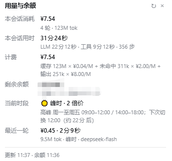

# dsh-usage-balance-v2

[中文](README.md) | English

A DSH Web plugin that puts a compact balance / session readout **inside the native usage line**, between the token usage group and the context percentage:

```
… 4.8M tok · cache hit 98%   [¥] ¥0.77  [⏱] 4m50s  [◉] ¥230.88 peak ⌄   13%
```

- **Coin icon** — current session cost
- **Clock icon** — current session duration
- **Wallet icon** — remaining balance
- **Peak / valley badge** — current DeepSeek pricing period

Click the readout to open the details card. There is **no automatic “turn finished” popup**; all details live in the card.

## Sidebar workspace totals

Each workspace header also gets a one-line lifetime total for all sessions in that workspace:

```
Envir              ¥48.14 · 4h25m
default-workspace  ¥4.90 · 1h8m
```

It is served by the companion [`workspace-usage-v2/`](workspace-usage-v2) host plugin: it reads
`.dsh-usage-balance-v2.json` and joins sessions through DSH’s `workspaceRegistry`.
The browser also posts the open session’s official `tokenUsage` / `sessionStats`
values; the host stores `max(ledger, official)` per session, so **a session can never
show a larger cost than its workspace total**. The label hides while the row is
hovered so the row actions have room.

## Screenshots

<p align="center">
  
</p>

<p align="center">
  
</p>

## What the details card shows

- **Session cost** — computed from DSH’s official `tokenUsage` projection for the whole session: cached-input, uncached-input and output tokens, each multiplied by the current peak/valley rate.
- **Session duration** — DSH’s official `sessionStats`: LLM time + tool time, plus step count.
- **Billing formula** — the exact multiplication is printed, e.g.  
  `cache 123M × ¥0.04/M + uncached 311k × ¥2.00/M + output 251k × ¥8.00/M`.
- **Remaining balance** — total, topped-up and granted components.
- **Current period** — peak/valley, the peak-hour rule, and a countdown to the next switch.
- **Last turn** — cost, duration, tokens, model and period, priced step by step with the actual peak/valley state of each step.

## Billing

Session cost is an estimate based on the official token usage:

```
cost = cacheReadTokens / 1e6 × cacheHitPrice
     + (uncachedInputTokens + cacheWriteTokens) / 1e6 × cacheMissPrice
     + outputTokens / 1e6 × outputPrice
```

The session readout uses the **current** period’s rates. The “last turn” value uses the exact peak/valley rate at each assistant step, so a turn crossing 12:00 or 18:00 is split correctly.

`reasoningTokens` is already included in `outputTokens` and is not charged twice.

## Peak / off-peak pricing

Beijing time:

- **Peak** — Monday to Friday (excluding Chinese statutory holidays), **09:00–12:00** and **14:00–18:00**
- **Valley** — all other periods, including weekends, make-up working weekends and statutory holidays
- **Peak price = valley price × 2**

Prices per million tokens, `[valley, peak]`:

| Model | Cache hit | Cache miss | Output |
| --- | --- | --- | --- |
| `deepseek-flash` / `deepseek-v4-flash` / `deepseek-v4-flash-vision-exp` | 0.02 / 0.04 | 1 / 2 | 4 / 8 |
| `deepseek-v4-pro` | 0.15 / 0.3 | 4.5 / 9 | 13.5 / 27 |

The table, peak hours and holiday list live in `lib/pricing.mjs` (`PRICING`, `PEAK_HOURS`, `HOLIDAY_VALLEY`). Add future statutory holidays there when the State Council publishes the next year’s schedule.

## Install

The plugin has no `@deepseek-ai/*` npm dependency, so it does not trigger DSH’s peer-version compatibility gate.

### 1. Clone and link it into the target profile

```powershell
git clone https://github.com/3493750852/dsh-usage-balance-v2.git
$plugin = (Resolve-Path .\dsh-usage-balance-v2).Path
New-Item -ItemType Junction `
  -Path "$env:USERPROFILE\.dsh\profiles\desktop\node_modules\dsh-usage-balance-v2" `
  -Target $plugin
```

Use the `web` profile instead of `desktop` if that is the profile you run.

### 2. Add the plugin to the profile patch

Append to `$env:USERPROFILE\.dsh\profiles\<profile>\cordis.patch.yml`:

```yaml
- insert:
    - id: dsh-usage-balance-v2
      name: dsh-usage-balance-v2
```

### 3. Install the sidebar workspace totals (optional)

```powershell
New-Item -ItemType Junction `
  -Path "$env:USERPROFILE\.dsh\profiles\desktop\node_modules\dsh-workspace-usage-v2" `
  -Target (Join-Path $plugin 'workspace-usage-v2')
```

Append to the same `cordis.patch.yml`:

```yaml
- insert:
    - id: dsh-workspace-usage-v2
      name: dsh-workspace-usage-v2
```

DSH profiles default to `patchReload: live`; save the file and refresh the page. If the readout still does not appear, restart DSH once.

### 4. Verify

```js
fetch('/dsh-usage-balance-v2/state.json').then((r) => r.json()).then(console.log)
fetch('/dsh-workspace-usage-v2/state.json').then((r) => r.json()).then(console.log)
```

The responses contain `totals`, `session`, `balance`, `pricing`, `lastTurn` and `active`,
and `workspaces` respectively.

## Data and privacy

Host state is stored in `$DSH_HOME/.dsh-usage-balance-v2.json`.

- The host keeps cumulative counters and the last turn from the moment the plugin is enabled.
- The **session** cost/duration shown outside come from DSH’s official projections and therefore cover the whole session, including turns from before the plugin was enabled.
- The browser never talks to DeepSeek and never sees an API key. The host resolves `DEEPSEEK_API_KEY` through DSH credentials, falling back to the signed-in DSH account service.

## Tests

```powershell
node --test test/pricing.test.mjs test/host-smoke.mjs
```

8 tests cover peak/valley switching, next-switch calculation, the price table, usage-to-cost math, turn aggregation, subagent suppression and on-disk state recovery.

## License

MIT. See [LICENSE](LICENSE).
